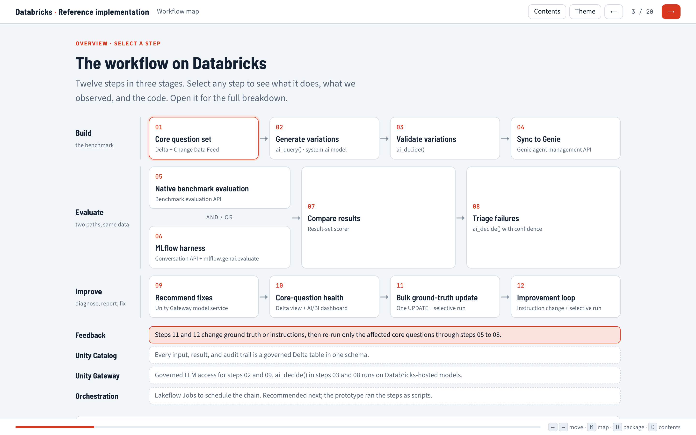
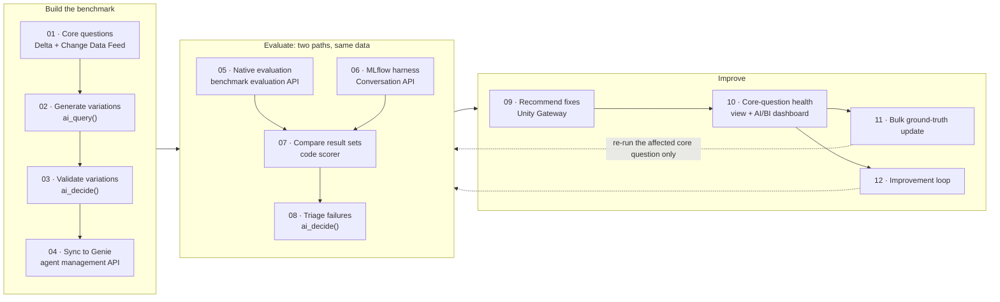
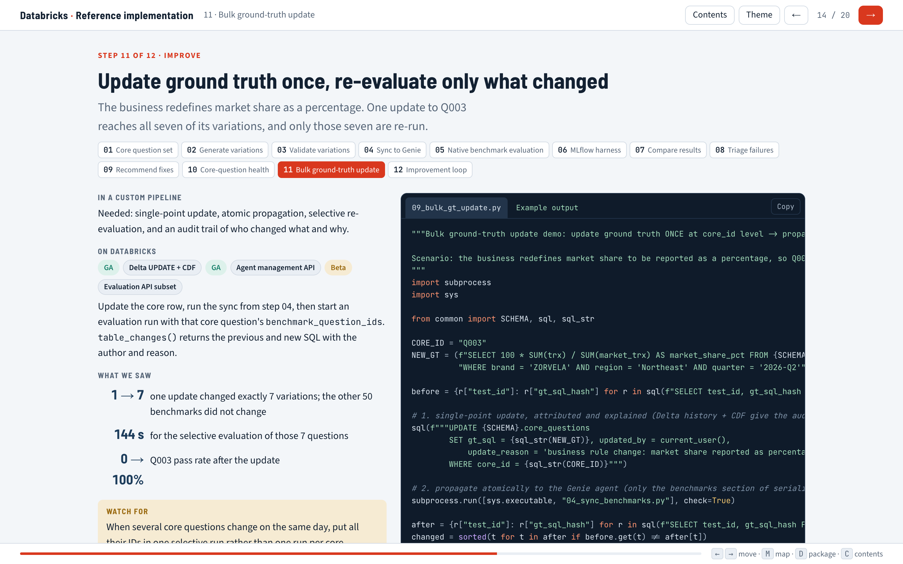
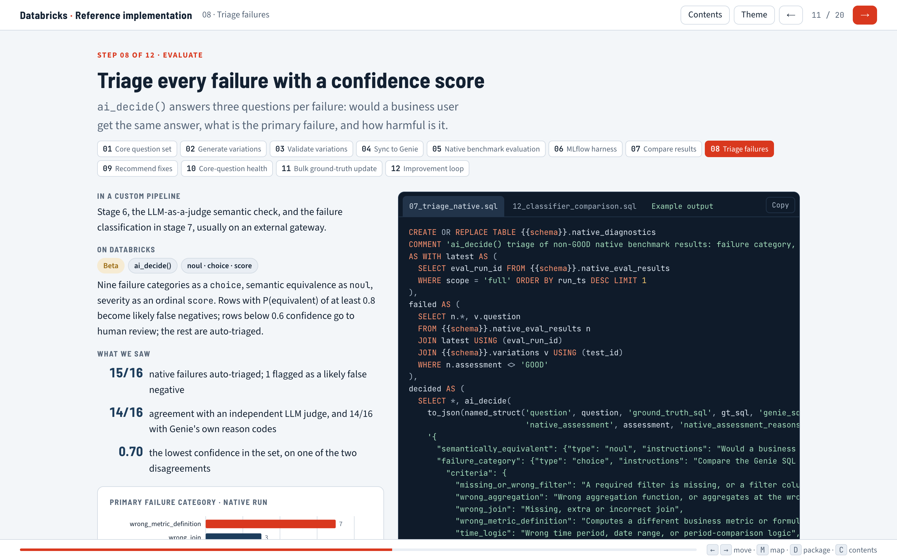

<div align="center">

# Extended Genie Evaluation Framework

**Evaluate Databricks Genie agents past the 500-benchmark limit, with health per core question,<br/>one-edit ground-truth updates, confidence-scored triage, and governed LLM steps. All native on Databricks.**


**[▶ Open the interactive walkthrough](https://guanyudb.github.io/extended-genie-eval-framework/)**

[Gaps it closes](#gaps-it-closes) · [How it works](#how-it-works) · [Results](#results-on-synthetic-data) · [Walkthrough deck](#interactive-walkthrough) · [Quick start](#quick-start)

</div>



## Why

Genie benchmarks are the built-in way to measure a Genie agent: each question is graded against ground-truth SQL. They work well for a curated set. Teams running Genie at scale hit the edges:

- An agent can need **1,000 to 1,500** benchmark questions, and it holds **500**.
- Every phrasing of a question carries **its own copy** of the ground-truth SQL, so one business-rule change means editing every copy.
- Grades are **per question**, so a weak core question hides inside one overall score.
- A grade and a reason code say **that** an answer failed, not **what to change**.

So teams build custom pipelines around Genie, often calling an external LLM for variations, judging, and reports. This repo builds that whole pipeline from native Databricks features, and runs it end to end on synthetic data.

## Gaps it closes

| Gap | Native Genie benchmarks | What this framework adds | Shown on synthetic data |
|---|---|---|---|
| **More than 500 questions per agent**<br/><sub>steps 05, 06</sub> | Up to 500 benchmark questions per agent | An **MLflow 3 harness** that asks Genie through the Conversation API, with no cap. The native evaluation API still runs batches of up to 500 from the same Delta master set. | 57 questions in 6 minutes with 4 workers |
| **One ground truth per core question**<br/><sub>steps 01, 04, 11</sub> | Each benchmark question holds its own ground-truth SQL | Ground-truth SQL lives **once**, on the core question, and every variation inherits it. One `UPDATE`, a sync, and a selective run re-check only that core question. Change Data Feed records who changed what and why. | 1 edit reached all 7 variations; re-checked in **144 s**; pass rate 0% → 100% |
| **Health per core question**<br/><sub>step 10</sub> | A grade per question and an overall score per run | A view that keeps the latest result per question from either path and rolls it up **by core question** with an 80% threshold, plus an AI/BI dashboard and MLflow metrics. | Both paths flagged the same 2 of 8 core questions |
| **Phrasing coverage you can trust**<br/><sub>steps 02, 03</sub> | Coverage depends on the questions you write | `ai_query()` writes variations in 8 categories from each ground-truth query. `ai_decide()` checks equivalence and ambiguity **with probabilities** and routes each variation to valid, invalid, or review. | 57 of 72 kept; **8 of 8** filter-changing variations rejected |
| **Why it failed, with confidence**<br/><sub>steps 07, 08</sub> | GOOD / BAD / needs-review grades with reason codes | A result-set comparison (match, partial, mismatch, error) feeds `ai_decide()` triage: failure category, semantic equivalence, and severity, **each with a confidence**. Low confidence goes to a person; likely false negatives are flagged. | 15 of 16 auto-triaged; **14 of 16** matched an independent LLM judge |
| **What to change**<br/><sub>step 09</sub> | Reason codes per question | One concrete instruction or metadata fix **per core question and failure pattern**, written through a Unity Gateway model service. | 9 failure patterns, 9 recommendations |
| **Proof that a fix worked**<br/><sub>step 12</sub> | Run all or selected benchmarks | Apply the fix through the agent management API, then re-run **only the affected core question** on both paths and compare before and after. | Harness pass rate **29% → 86%** after one instruction |
| **Governed LLM steps**<br/><sub>steps 02, 03, 08, 09</sub> | Custom pipelines often call an external LLM gateway | Every LLM call stays on Databricks: `ai_query()` and `ai_decide()` on hosted models, or a **Unity Gateway model service** that can front your existing gateway as a custom provider. Unity Catalog permissions, and every call logged in `system.ai_gateway.usage`. | 26 model-service calls logged with requester and tokens |

## How it works

Twelve steps in three stages. Both evaluation paths read the same Delta master set, and every input, result, and audit record is a governed table in one Unity Catalog schema.



| Step 11: update ground truth once, re-run only what changed | Step 08: triage every failure with a confidence |
|---|---|
|  |  |

## Results on synthetic data

8 core questions produced 57 validated benchmark questions, which were evaluated both ways.

| | Native evaluation | MLflow harness |
|---|---|---|
| Questions evaluated | 57 | 57 |
| First-pass rate | **72%** (41 of 57) | **79%** (45 of 57) |
| Throughput we observed | about 3.2 questions per minute | 9.5 questions per minute with 4 workers |
| Weak core questions found | Q003, Q007 | Q003, Q007 |

- **Triage:** `ai_decide()` matched an independent LLM judge on 14 of 16 failures, and Genie's own reason codes on 14 of 16.
- **Ground-truth change:** redefining market share as a percentage was one update. It reached exactly 7 variations, left the other 50 benchmarks untouched, and a 144-second selective run took that core question from 0% to 100%.
- **Instruction fix:** one recommended instruction took the weakest core question from 29% to 86% in the harness. Only its 7 variations were re-run.

Numbers come from one Databricks workspace. Yours will differ.

## Interactive walkthrough

[`docs/index.html`](docs/index.html) is a self-contained, 20-slide deck: the workflow map, then one slide per step with what it does, what we saw, the code, and example output, followed by results, governance options, and planning for scale.

Open it at **https://guanyudb.github.io/extended-genie-eval-framework/**, or download the file and open it in a browser. Keys: <kbd>←</kbd> <kbd>→</kbd> move, <kbd>M</kbd> map, <kbd>D</kbd> repository contents, <kbd>C</kbd> contents.

## Built on

| Capability | Used for | Status |
|---|---|---|
| Unity Catalog Delta tables + Change Data Feed | master set, results, audit trail | GA |
| `ai_query()` | variation generation, fix recommendations | GA |
| `ai_decide()` | variation validation, failure triage | **Beta** |
| Genie agent management API | benchmark sync, instruction fixes | GA |
| Genie benchmark evaluation API | native runs, selective re-runs (chat mode) | **Beta** |
| Genie Conversation API | MLflow harness | GA |
| MLflow 3 `mlflow.genai.evaluate` + tracing | harness, scorers, per-core metrics | GA |
| Unity Gateway model service | governed LLM calls and usage logging | GA |
| AI/BI dashboards | core-question health | GA |
| Lakeflow Jobs | scheduling the chain (recommended next; the scripts here run standalone) | GA |

## Quick start

```bash
git clone https://github.com/guanyudb/extended-genie-eval-framework.git
cd extended-genie-eval-framework/src
pip install -r requirements.txt

export DATABRICKS_CONFIG_PROFILE=<your-profile>
export GENIE_EVAL_SCHEMA=<catalog>.<schema>
export GENIE_EVAL_WAREHOUSE_ID=<warehouse-id>

python run_sql.py 01a_synthetic_data.sql 01b_synthetic_data.sql 02a_core_questions.sql 02b_core_questions.sql
python run_sql.py 03a_generate_variations.sql 03b_validate_variations.sql
python 04_sync_benchmarks.py                          # creates the Genie agent and syncs benchmarks
python 05_native_eval.py                              # native benchmark evaluation
python 06_custom_harness.py --run-name harness-full   # MLflow harness
```

[`src/README.md`](src/README.md) covers the prerequisites (including the `ai_decide()` preview and the Unity Gateway model service the harness calls), the full run order for all 12 steps, the dashboard, and how to adapt it to your own agents.

## Repository layout

```text
.
├── docs/
│   ├── index.html                interactive walkthrough (self-contained)
│   └── images/                   screenshots used in this README
└── src/
    ├── README.md                 prerequisites, setup, run order, adapting it
    ├── common.py  run_sql.py  requirements.txt
    ├── 01a, 01b, 02a, 02b *.sql  synthetic data and core questions        (step 01)
    ├── 03a, 03b *.sql            generate and validate variations         (steps 02, 03)
    ├── 04, 05, 06 *.py           sync, native evaluation, MLflow harness  (steps 04 to 08)
    ├── 07, 07b *.sql             triage and fix recommendations           (steps 08, 09)
    ├── 08b *.sql, 10_dashboard   core-question health view and dashboard  (step 10)
    ├── 09, 11 *.py               bulk ground-truth update, instruction fix (steps 11, 12)
    └── 12 *.sql                  optional: ai_decide() against an LLM judge
```

## Notes

- **Provided as-is.** This is a reference implementation, not a Databricks product or supported software, and it has not been hardened for production.
- **Beta features.** `ai_decide()` and the Genie benchmark evaluation API are Beta and may change. The evaluation API covers chat mode.
- **Synthetic data.** All data is synthetic, and the brand names are fictional.
- **Throughput.** Conversation API throughput is limited per workspace and shared by every Genie agent there. Size it for full runs with your Databricks account team.
